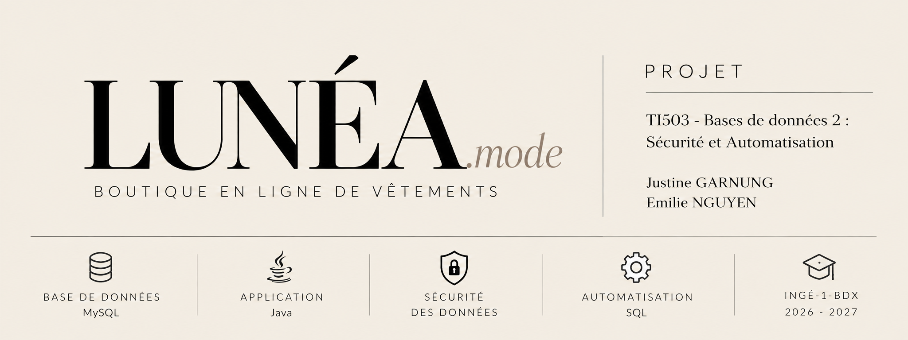

<p align="center">
  
</p>
<div align="center"> <h1>✦</h1> <h3>LUNÉA</h3> <p><em>Online clothing store.</em></p> <p>     </p> <p><strong>01 — DESIGN</strong> &nbsp; ✦ &nbsp; <strong>02 — DATA</strong> &nbsp; ✦ &nbsp; <strong>03 — SECURITY</strong></p> </div>

---

## 01 — À propos

**LUNÉA.mode** est un projet de boutique de vêtements en ligne réalisé dans le cadre du module **TI503 — Bases de données 2 : Sécurité et Automatisation**.

L'objectif est de concevoir une application web en **Java**, connectée à une base de données **MySQL**, permettant de gérer les différentes opérations d'une plateforme e-commerce.

**... (faut dire d'autres trucs mais je sais pas quoi pour le moment)**

---

## 02 — Technologies utilisées

| Technologie | Utilisation |
|:---|:---|
| **Java** | Développement de l'application web |
| **MySQL 8** | Système de gestion de base de données |
| **SQL** | Requêtes, vues, procédures, fonctions et triggers |
| **Git** | Gestion des versions |
| **GitHub** | Hébergement du projet et collaboration |

---

## 03 — Architecture de la base de données

La base de données **`boutique_en_ligne`** est organisée autour de **8 tables principales**.

| Table | Description |
|:---|:---|
| `clients` | Informations personnelles des clients |
| `adresse` | Adresses de livraison et de facturation |
| `categorie` | Classification des articles |
| `produit` | Catalogue, prix et stocks |
| `commande` | Commandes effectuées par les clients |
| `ligne_commande` | Détails des produits commandés |
| `paiement` | Transactions et statuts de paiement |
| `mouvement_stock` | Historique des entrées et sorties de stock |

---

## 04 — Fonctionnalités du projet

### Gestion de la boutique

- La consultation du catalogue de vêtements.
- La gestion des informations clients.
- La création et le suivi des commandes.
- Le suivi des paiements.
- La gestion des catégories et des produits.
- La consultation et la mise à jour des stocks.
- ...

---

## 05 — Sécurité des données

L'objectif était de limiter les accès aux informations selon les responsabilités de chaque utilisateur.

### Les trois profils

| Profil | Responsabilités |
|:---|:---|
| **Client** | Consulter le catalogue et accéder à ses propres commandes |
| **Gestionnaire** | Gérer les produits, les stocks et le suivi des commandes |
| **Administrateur** | Superviser les opérations de gestion autorisées |

### Principes de sécurité

Notre approche repose sur :

- Le principe du **moindre privilège**.
- La séparation des responsabilités.
- La protection des données des clients.
- La vérification de l'intégrité des transactions.
- La gestion des autorisations au niveau de MySQL.

**Remarque technique :**

MySQL ne propose pas de Row-Level Security native équivalente à celle de PostgreSQL, ni de vues matérialisées natives.
On a donc trouver des "sortes" de solutions alternatives.

---

## 06 — Organisation du dépôt

L'arborescence de notre projet est la suivante :

```text
LUNEA/
│
├── assets/
│   └── lunea.png
│
├── sql/
│   ├── 01_schema.sql
│   ├── 02_data.sql
│   ├── 03_views.sql
│   ├── 04_functions_procedures.sql
│   ├── 05_triggers.sql
│   ├── 06_security.sql
│   └── 07_tests.sql
│
├── app/
│   └── ...                  # Application Java
│
├── docs/
│   ├── ...                  # MCD et MLD
│   └── ...                  # Rapport
│
└── README.md
```

---

## 07 — Équipe

<div align="center">

### Justine GARNUNG & Emilie NGUYEN

**INGÉ-1-BDX**

**Année 2026–2027**

TI503 — Bases de données 2 : Sécurité et Automatisation

</div>

---

<div align="center">

### LUNÉA.mode

*Designed with style. Built with logic.*

**© 2026–2027 — Projet fin de module**

</div>
